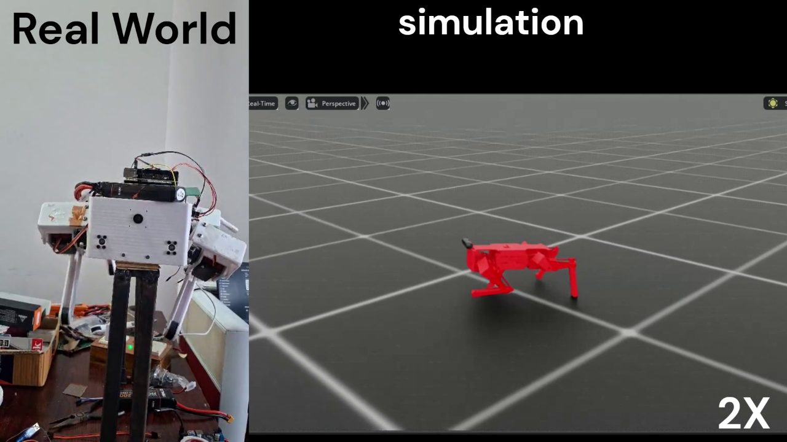
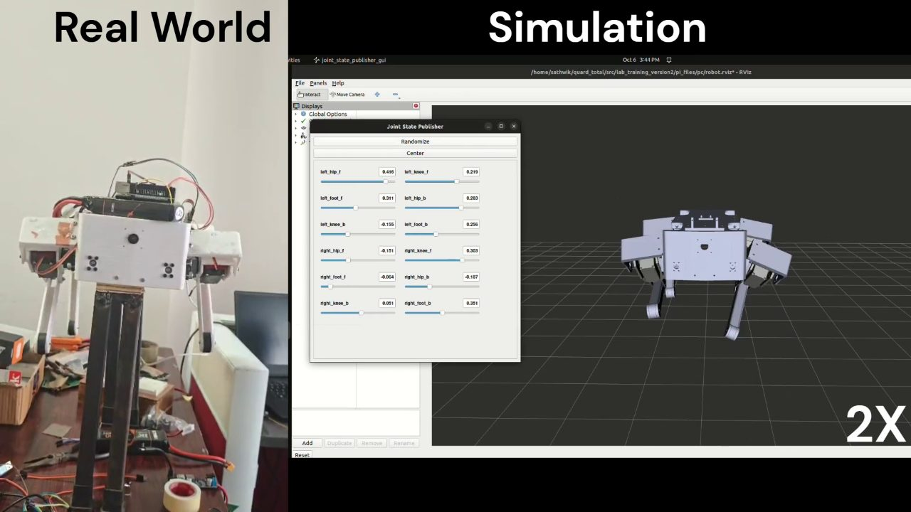
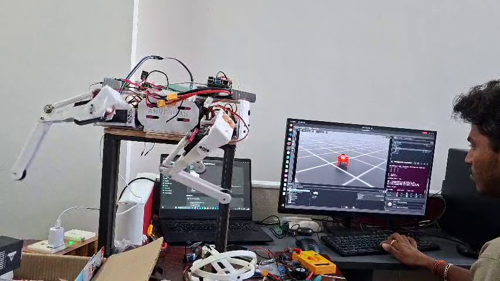
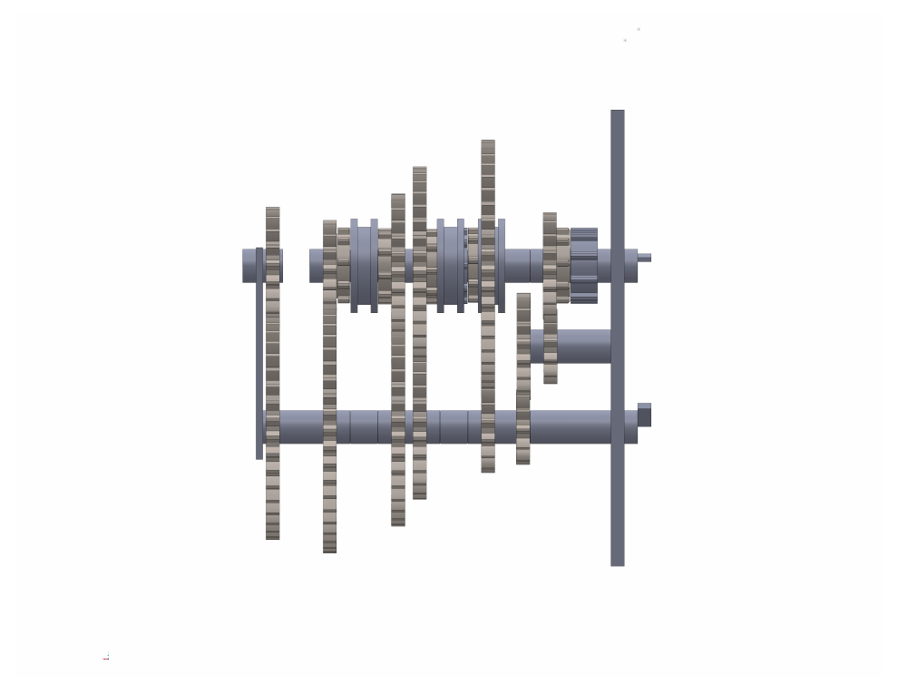
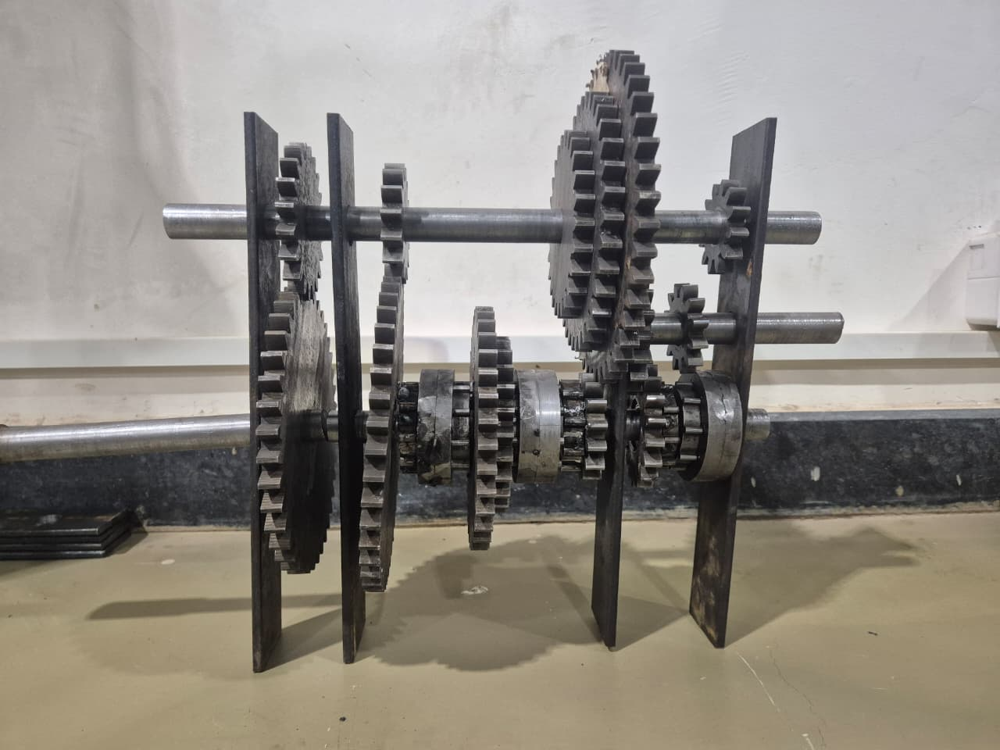
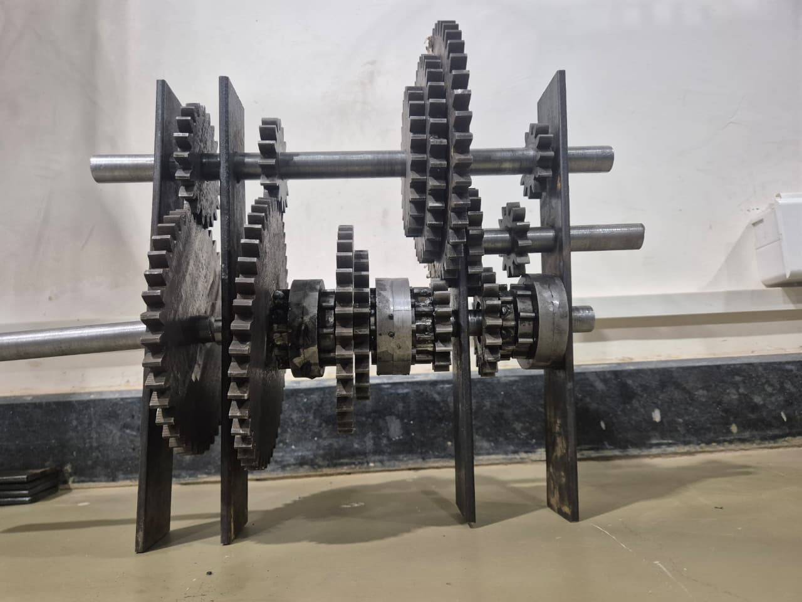
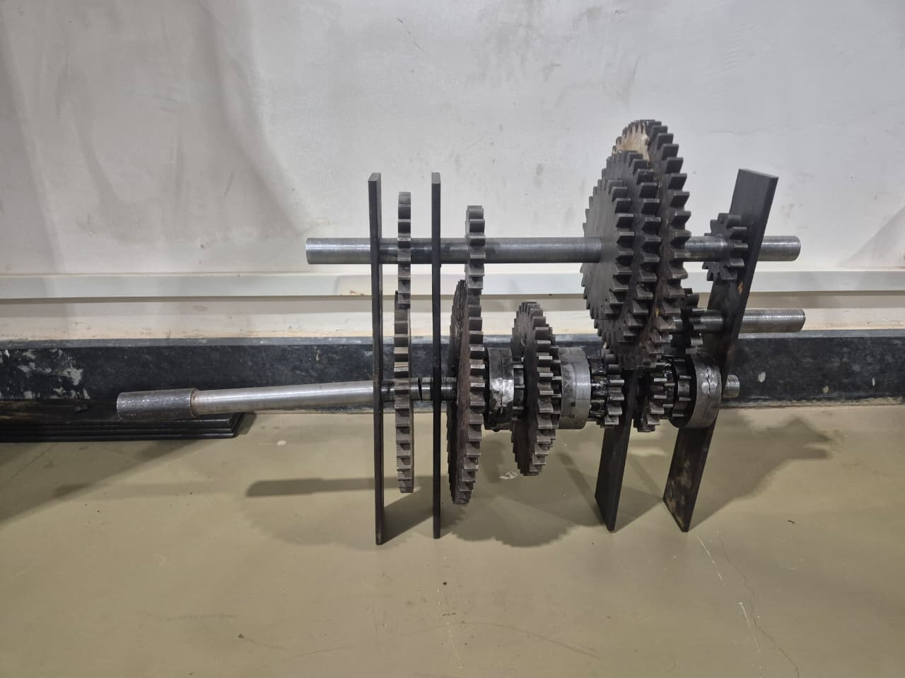

# Sathwik Munigala - CV and Project Media

B.Tech Mechanical Engineering, Minor in Robotics, IIITDM Kurnool (2023-2027)

## CV

[Sathwik_Munigala_CV.pdf](cv/Sathwik_Munigala_CV.pdf)

## Quadruped robot: simulation to real robot

A 12-degree-of-freedom four-legged robot. The motion produced in simulation is reproduced on
the real robot in real time.

### Walking gait

The walking gait runs in the simulation (right) and the real robot, on a test stand (left),
performs the same leg motion at the same time. Shown at 2x speed.

Video: [videos/sim_to_real_walking_gait.mp4](videos/sim_to_real_walking_gait.mp4)

### Joint check

Each joint is moved from the simulation interface (right) and the same joint of the real
robot (left) follows it. Shown at 2x speed.

Video: [videos/sim_to_real_joint_check.mp4](videos/sim_to_real_joint_check.mp4)

### Real robot with the live simulation

One unedited recording: the simulation runs on the screen and the real robot beside it moves
its legs with it.

Video: [videos/real_robot_with_live_simulation.mp4](videos/real_robot_with_live_simulation.mp4)

## Manual gear transmission system

Design and fabrication of a manual gear transmission: CAD model of the assembly and the
fabricated gearbox.

CAD assembly ([PDF](gear_transmission/cad_assembly.pdf)):

Fabricated gearbox:

## Contact

For more technical details, please contact me.

- LinkedIn: https://www.linkedin.com/in/sathwik-munigala-794447289/
- GitHub: https://github.com/sathwik58
